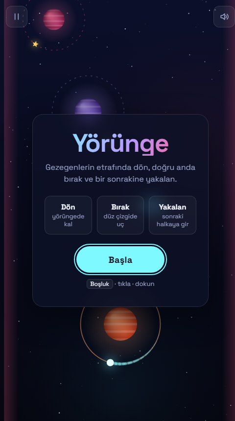
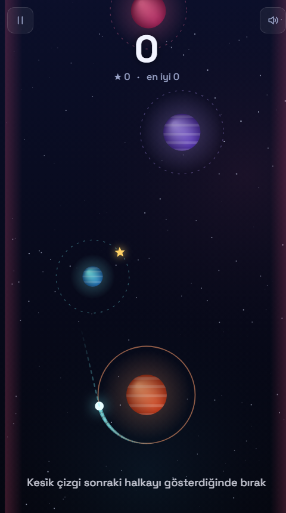

# Yörünge

Tek tuşla oynanan bir uzay oyunu. Gezegenlerin etrafında dön, doğru anda bırak ve bir sonrakinin yörüngesine yakalan.

**[▶ Hemen oyna](https://enskygr234.github.io/yorunge/)**

  
  

## Nasıl oynanır

- Kuyruklu yıldızın bir gezegenin etrafında döner.
- **Boşluk**, **tıklama** ya da **dokunma** ile yörüngeden kopar ve düz bir çizgide uçarsın.
- Bir sonraki gezegenin kesik çizgili halkasına girersen ona yakalanırsın.
- Her yeni gezegen ve her altın yıldız **+1 puan**.

**Oyun biter:** kenarlardan çıkarsan, aşağı düşersen ya da uzayda çok uzun süre sürüklenirsen.

**Zorlaşır:** 3. gezegenden sonra her yörüngede süre sınırı başlar; hız artar, mesafeler açılır ve bazı gezegenler hareket etmeye başlar.

## Kontroller

| Tuş | İşlev |
| --- | --- |
| `Boşluk` / `↑` / tıkla / dokun | Bırak · Başla |
| `P` / `Esc` | Duraklat |
| `M` | Sesi aç / kapat |

## Teknik

Tek HTML dosyası, saf JavaScript ve Canvas 2D. Bağımlılık yok (yalnızca Google Fonts'tan Space Grotesk). En iyi skor tarayıcıda saklanır.

Başlangıç ekranının arkasında oyunu kendi kendine oynayan bir demo bot çalışır. `index.html?demo=1` adresi, botun puanlı gerçek bir turu oynamasını sağlar (test için).
